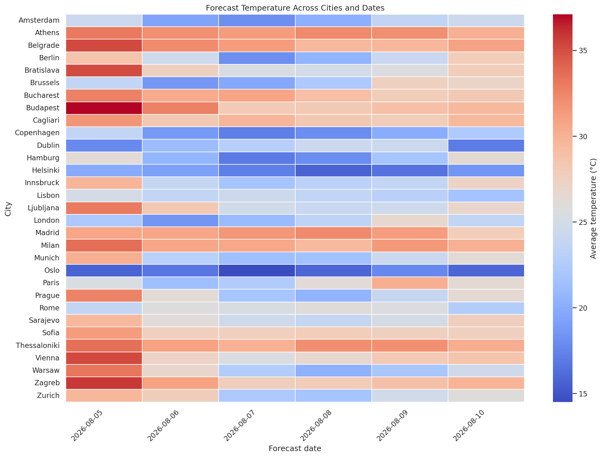
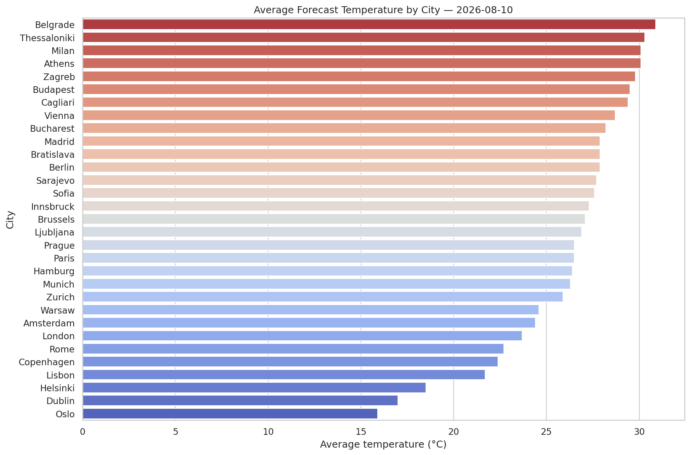
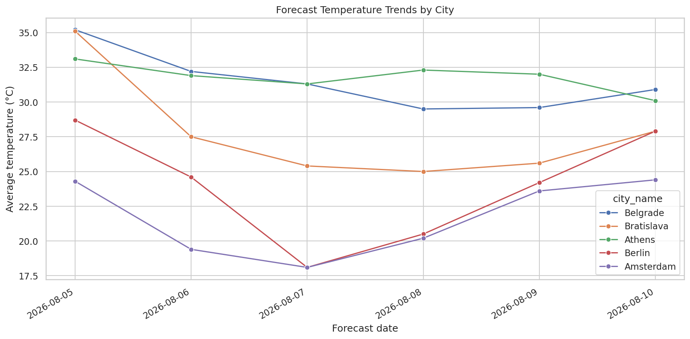

# European Weather Data Engineering Pipeline

A containerized data engineering project that collects weather forecasts for 31 European cities and transforms them into structured datasets for analytical queries and visualization. The project combines Python, PySpark, DuckDB SQL, Docker, and Seaborn in a layered data pipeline.

**Status:** Work in Progress: tests are missing, more visualizations and gold datasets are planned.

---

## Overview

The pipeline retrieves forecast data from the OpenWeather API, stores raw JSON files, processes them into validated Parquet datasets, and generates analytical outputs using SQL. Python visualization scripts then use the gold layer data to explore temperature patterns across cities and forecast dates.

The project follows a **Bronze–Silver–Gold architecture** inspired by the medallion data lake pattern.


## Features

### Bronze Layer
- Retrieves weather forecast data for 31 European cities using the OpenWeather API.
- Stores raw API responses as JSON files organized by date and time.
- Preserves raw data for subsequent processing.

### Silver Layer
- Uses PySpark to transform raw JSON data into structured datasets.
- Normalizes timestamps and weather-related fields.
- Applies data validation and deduplication.
- Stores cleaned data in partitioned Parquet files.

### Gold Layer

- Uses DuckDB SQL to query Silver-layer Parquet datasets directly.
- Produces analytical datasets, including daily average temperature rankings by city.
- Stores query results as Parquet files for efficient downstream analysis.


### Visualization

- Uses Pandas to load Gold-layer Parquet datasets.
- Uses Seaborn and Matplotlib to generate:
   - Temperature heatmap: Explore temperature differences across cities and forecast dates.
   - Temperature rankings: Compare average forecast temperatures across cities for a selected date.
   - Temperature trends: Compare forecast temperature patterns across cities and dates.
- Saves generated charts as PNG images for further analysis and reporting.







---

### Technologies

**Python** — ingestion, orchestration, data loading, and visualization <br>
**OpenWeather API** — weather forecast data source <br>
**PySpark** — ETL and data transformation <br>
**DuckDB SQL** — analytical queries and Gold-layer generation <br>
**Parquet** — columnar storage for structured datasets <br>
**Pandas** — tabular data manipulation <br>
**Seaborn & Matplotlib** — data visualization <br>
**Docker** — reproducible execution environment <br>
**pytest** — planned testing for visualization components <br>


---

## Project structure

```text
.
├── data/
│   ├── bronze/
│   ├── silver/
│   └── gold/
├── sql/
├── visualizations/
│   ├── __init__.py
│   ├── data_loader.py
│   ├── plots.py
│   ├── main.py
│   └── output/
├── ingest_weather.py
├── bronze_to_silver.py
├── make_gold_sql.py
├── Dockerfile
└── README.md
```

---

## Data model

### Bronze layer

The Bronze layer preserves the raw API payload while adding ingestion metadata.

Each hourly JSON file contains one record per city.

Example:

```json
{
  "metadata": {
    "city_name": "Vienna",
    "source": {
      "provider": "OpenWeather",
      "endpoint": "forecast"
    },
    "ingestion_timestamp": "...",
    "forecast_timestamp": "..."
  },
  "city": { ... },
  "payload": { ... }
}
```

### Silver layer

The Silver layer transforms nested JSON into a flat analytical table.

| Column | Description |
|---------|-------------|
| city_name | City |
| country | ISO country code |
| latitude / longitude | Geographic coordinates |
| forecast_timestamp | Forecasted observation time |
| ingestion_timestamp | Pipeline ingestion time |
| temp_celsius | Temperature |
| feels_like_celsius | Apparent temperature |
| humidity_percent | Relative humidity |
| pressure_hpa | Atmospheric pressure |
| wind_speed_m_s | Wind speed |
| wind_direction_deg | Wind direction |
| cloud_cover_percent | Cloud coverage |
| weather_main | Weather category |
| weather_description | Detailed description |

The Silver dataset is stored as **partitioned Parquet** for efficient analytical queries.

---

## Running the project

**Note**: The structure may evolve as additional features are introduced. This itself section needs some improvements, which are planned.

### Option 1 (recommended): Docker

Build the container:

```bash
docker build -t weather-data-lake .
```

1. **Run it:**

```bash
docker run -it \
  -v $(pwd):/workspace \
  weather-data-lake
```

2. **Inside the container:**

```bash
python ingest_weather.py --start-date DD-MM-YYYY --end-date DD-MM-YYYY

python bronze_to_silver.py
```

3. **Generate Gold datasets**

Run the SQL execution script from the project root:
```bash
python make_gold_sql.py
```
This executes the DuckDB SQL query and generates analytical Parquet datasets in the Gold layer.


5. **Generate visualizations**

This step needs additional dependencies, which one can install (inside or outside the Docker container) with:
```bash
python -m pip install pandas pyarrow seaborn matplotlib
```
From the project root, run:
```bash
python -m visualizations.main
```
The resulting charts are saved to visualizations/output/.


---

### Option 2: Local Python environment

Requirements:

- Python 3.12+
- Java (JDK 17 or compatible)
- PySpark
- Requests
- ...(work in progress)

Install dependencies:

```bash
pip install pyspark requests
```

Set your API key:

```bash
export OPENWEATHER_API_KEY="your_api_key"
```

---

## ETL pipeline

### Bronze ingestion

- Reads city list from a text file
- Downloads 5-day forecasts from OpenWeather (going from the current day, and up to 5 days from then)
- Generates hourly sampling
- Stores partitioned JSON files

### Bronze → Silver

- Reads all Bronze partitions recursively
- Flattens nested weather structures
- Validates numerical ranges
- Removes duplicate ingestion records
- Writes Hive-partitioned Parquet
